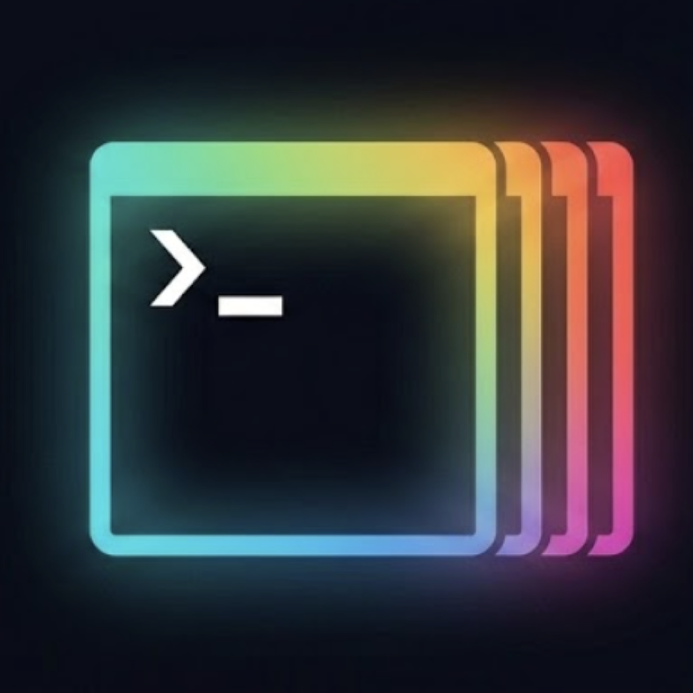
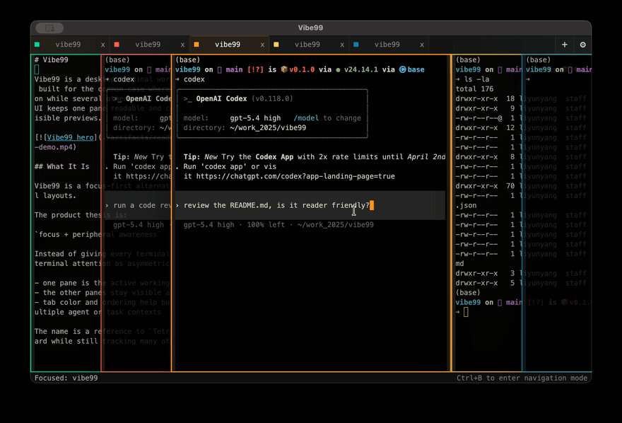

<p align="center">
  
</p>

<h1 align="center">Vibe99</h1>

<p align="center">
  Desktop terminal workspace for agentic coding.
</p>

<p align="center">
  <a href="https://github.com/yarray/Vibe99/blob/main/LICENSE"></a>
  
  
</p>

Vibe99 is a desktop terminal workspace designed for agentic coding. The UI keeps one pane readable and stacks the rest so you can monitor what agents are doing without losing focus on your active session.



## Features

- **Spotlight + stack multi-pane layout** — one terminal gets full width while the rest stack on the side, each showing the last few lines of output. You always know what every agent is doing without juggling windows or tabs.
- **Activity alerts** — when a backgrounded pane finishes output and goes idle, it pulses with a breathing mask so you can tell at a glance which agent needs attention. Global and per-pane toggles.
- **Session restore** — pane layout, working directories (tracked via OSC 7), shell profiles, and tab titles all survive app restart. Pick up exactly where you left off.
- **Layout system** — save a pane arrangement, switch between saved layouts, open layouts in separate windows, and set layouts to auto-start on boot.
- **Navigation mode** — `Ctrl+B` enters a vim-style mode: move with `h`/`l`, jump by number (`1`–`9`), close (`x`), rename (`r`), then `Enter` to focus.
- **Per-pane shell profiles** — each pane can run a different shell. Create profiles for bash, zsh, SSH, Docker, or any command. WSL distributions on Windows are auto-detected.

For detailed feature documentation with animated demonstrations, see [docs/features/](./docs/features/).

## Installation

### Pre-built Binaries

Download the latest release for your platform from [GitHub Releases](https://github.com/yarray/Vibe99/releases):

| Platform | Formats |
|----------|---------|
| Linux | `.AppImage`, `.deb` |
| Windows | `.msi`, `.exe` (portable) |

macOS builds are paused until signing and notarization demand justifies the cost.

### Build from Source

**Prerequisites:**

- [Node.js](https://nodejs.org/) 22
- [Rust](https://rustup.rs/) stable (up to date — run `rustup update stable` if the build fails)
- Platform-specific Tauri dependencies:

**Linux (Ubuntu 22.04+):**

```bash
sudo apt install libwebkit2gtk-4.1-dev build-essential curl wget file \
  libxdo-dev libssl-dev libayatana-appindicator3-dev librsvg2-dev
```

**Linux (Ubuntu 20.04):**

Ubuntu 20.04's default repos lack the Tauri v2 system dependencies. Use the provided setup script:

```bash
sudo bash scripts/setup-build-deps-ubuntu2004.sh
source .build-env.sh
```

**Windows / macOS:**

No extra system packages needed — the Tauri CLI handles the rest.

**Build:**

```bash
npm install
npm run tauri:dev    # development (Vite on :1420 + native shell)
npm run tauri:build  # release artifacts
```

## Usage

### Keyboard Shortcuts

#### Global

| Shortcut | Action |
|----------|--------|
| `Ctrl+N` | New pane |
| `Ctrl+Shift+N` | New pane with profile picker |
| `Ctrl+Tab` / `Ctrl+Shift+Tab` | Cycle panes in MRU order (forward / reverse) |
| `Ctrl+←` / `Ctrl+→` | Spatial navigation between panes |
| <code>Ctrl+\`</code> | Cycle to the next pane with an active alert |
| `Ctrl+B` | Enter navigation mode |
| `Ctrl+Shift+O` | Tab switcher palette (fuzzy search) |
| `Ctrl+Shift+P` | Command palette (profile, color, rename, settings) |
| `Ctrl+Shift+L` | Open layouts dropdown |
| `Ctrl+Shift+C` / `Ctrl+Shift+V` | Copy / paste |

#### Navigation Mode (`Ctrl+B`)

Number badges appear on tabs. All single-key shortcuts below are only active in this mode:

| Key | Action |
|-----|--------|
| `h` / `←` | Previous pane |
| `l` / `→` | Next pane |
| `1`–`9` | Jump to pane by number |
| `Home` / `End` | First / last pane |
| `n` | New pane |
| `x` | Close pane (with confirmation) |
| `r` | Rename pane |
| `Enter` | Focus selected pane and exit navigation mode |
| `Esc` | Cancel |

#### Mouse

| Action | How |
|--------|-----|
| Rename a tab | Double-click the tab |
| Reorder tabs | Drag the tab |
| Change profile | Right-click the terminal → Change Profile → select |
| Change pane color | Right-click → Change Color… |
| Toggle activity alert | Right-click → Background activity alert |

### Layouts

Layouts save the complete state of a window: number of panes, their working directories, shell profiles, tab titles, and colors.

- **Save current layout**: Click `▦` in the toolbar → "Save Layout As…", or `Ctrl+Shift+L` → "Save Layout As…"
- **Open a layout**: Click `▦` → click a layout to open it in a window (new window if not already open, otherwise focus the existing one)
- **Manage layouts**: Click `▦` → "Manage Layouts…" to open the Layout Manager modal, where you can create, rename, delete layouts, configure default layout and auto-start, set global hotkeys, and view pane details
- **Set as Default**: In Layout Manager, click "Set as Default" on a layout — this layout becomes the template for new windows and is loaded when the app starts normally
- **Auto-start on boot**: In Layout Manager, select a layout → toggle "Auto-start on boot" — the layout opens automatically when the app starts at system boot. Multiple layouts can be set to auto-start simultaneously
- **Open in new window**: In Layout Manager, click `⎆` on a layout to open it in a separate window

### Shell Profiles

Each pane can run a different shell (bash, zsh, SSH, Docker, or any command).

**Managing profiles:**

1. Open **Settings** (gear) → **Shell Profiles**
2. Click `+` to create a new profile, or select an existing one to edit
3. Each profile has: **Name** (display label), **ID** (unique identifier), **Command** (executable path), **Arguments** (shell args)
4. Use `★` to set a profile as the default for new panes
5. Use `⧉` to clone a profile, drag to reorder
6. Auto-detected profiles (system shells, WSL on Windows) appear in the list but cannot be edited or deleted — clone one to customize it

**Using profiles:**

- Right-click inside a terminal → **Change Profile** → select to switch that pane's shell instantly
- `Ctrl+Shift+N` opens a profile picker to create a new pane with a specific shell
- Each pane's profile is saved in session state and restored on restart

## CLI Control (`vibe99ctl`)

`vibe99ctl` talks to a running Vibe99 instance over a local socket (Unix socket,
Windows named pipe), so scripts and coding agents can drive the workspace
without touching the UI. Build it next to the app:

```bash
cargo build --release --bin vibe99ctl --manifest-path src-tauri/Cargo.toml
```

Then, with Vibe99 running:

```bash
vibe99ctl pane list
vibe99ctl layout list
vibe99ctl layout activate work
```

### Settings

`settings get` prints the whole `settings.json` (stable key order) or a single
value; `settings schema` lists every writable key with its type, range and
default.

```bash
vibe99ctl settings get                  # full config
vibe99ctl settings get fontSize         # one value
vibe99ctl settings schema               # writable keys, ranges, defaults
```

`settings set` validates the value, persists it, and tells every open window to
reload and re-apply it — the change is visible immediately, no restart needed
(WebGL is the exception: it only takes effect after a restart).

```bash
vibe99ctl settings set fontSize 16                     # terminal font size
vibe99ctl settings set breathingIntensity intense      # none | mild | intense
vibe99ctl settings set activityAlertDebounceMs 15000   # alert debounce (ms)
vibe99ctl settings set fontFamily "Fira Code"          # font family
vibe99ctl settings set layoutHotkeys --json '{"work": "F1"}'
vibe99ctl settings set quakeLayouts --json '{"work": {"position": "bottom", "height": 50}}'
vibe99ctl settings set '{"fontSize": 16, "paneOpacity": 0.9}'   # several at once
```

Rules:

- A bare key is a writable UI setting (see `settings schema`). Dotted paths
  reach other sections: `settings get shell.defaultProfile`.
- Values are parsed according to the field's type, so `fontSize 16` sets an
  integer while `fontFamily 999` sets the string `"999"`. Pass `--json` to force
  JSON parsing (needed for objects, arrays and explicit JSON types).
- Invalid values are rejected with the field name and accepted range — e.g.
  `fontSize: expected integer 10-24, got 99` — and nothing is written.
- On success the command prints `{"ok": true, "changed": {...}}` with the values
  that were applied.

### Profiles

`vibe99ctl` controls a running Vibe99 window over a local socket
(`$XDG_RUNTIME_DIR/vibe99/vibe99.sock`, or a named pipe on Windows). It is
designed to be driven by agents and scripts.

```bash
# tmux resume: ssh in and attach (or create) the "work" session
vibe99ctl profile create --name work --command ssh --open --args -t host "tmux new -A -s work"

# zellij resume
vibe99ctl profile create --name zellij --command ssh --open --args -t host "zellij attach --create work"

# The same thing in two steps
vibe99ctl profile create --name work --command ssh --args '-t host "tmux new -A -s work"'
vibe99ctl pane create --profile work

vibe99ctl profile list          # alias of `shell list`
vibe99ctl profile update work --name Work --command ssh --args -t host "tmux new -A -s work"
vibe99ctl profile delete work
```

- `--args` consumes everything after it, so put the other flags first. Spell the
  arguments as a single quoted token when the remote command itself contains
  quotes (`--args '-t host "tmux new -A -s work"'`); a single token is stored
  verbatim. With separate tokens, the CLI re-quotes tokens containing spaces
  before saving.
- Profiles written by the CLI go through the same settings path as the UI and
  appear immediately in `profile list`, the **Shell Profiles** modal, and the
  **Change Profile** menu.
- Auto-detected profiles (system shells, WSL distributions) are read-only:
  `profile update` / `profile delete` refuse them, so create a copy under a new
  id instead.
- Creating a profile whose id or display name is already in use fails instead
  of silently overwriting the existing profile.
- `profile create --open` creates the profile and opens a pane with it in one
  call; `pane create --profile <id>` does the same in two steps (`--shell` is an
  alias).

## Project Structure

```
Vibe99/
├── src/                        # Frontend (vanilla JS + xterm.js)
│   ├── index.html              # App shell
│   ├── renderer.js             # Main renderer (panes, tabs, settings)
│   ├── styles.css              # Global styles
│   ├── input/                  # Keyboard input pipeline
│   │   ├── keymap.js           # Declarative shortcut definitions
│   │   ├── actions.js          # Action handlers (side-effects)
│   │   └── dispatcher.js       # Key → action dispatch
│   ├── command-palette.js      # Tab switcher & command palette
│   ├── colors-registry.js      # Accent palette & preset colors
│   ├── pane-activity-watcher.js # Activity detection for alerts
│   └── pane-alert-breathing-mask.js # Pulsing mask renderer
├── src-tauri/                  # Rust backend (Tauri 2)
│   ├── src/
│   │   ├── main.rs             # App entry point
│   │   ├── lib.rs              # Tauri setup & command registration
│   │   ├── pty.rs              # PTY session manager
│   │   ├── wsl.rs              # WSL distribution detection
│   │   └── commands/           # Tauri IPC commands
│   │       ├── terminal.rs     # Terminal CRUD
│   │       ├── settings.rs     # Settings load/save
│   │       ├── layout.rs       # Layout CRUD
│   │       ├── shell_profile.rs # Shell profile management
│   │       └── context_menu.rs  # Context menu handling
│   ├── Cargo.toml
│   └── tauri.conf.json
├── scripts/                    # Build & release tooling
├── docs/                       # Design documents
├── CONTRIBUTING.md
├── PRD.md
└── towncrier.toml
```

## Tech Stack

| Layer | Technology |
|-------|-----------|
| Framework | [Tauri 2](https://v2.tauri.app/) |
| Frontend | Vanilla JS, [xterm.js](https://xtermjs.org/) (WebGL renderer) |
| Backend | Rust, [portable-pty](https://docs.rs/portable-pty) |
| Build | [Vite](https://vitejs.dev/) |

## E2E Testing

``` bash
docker run --rm --privileged -v $PWD:/mnt/source:ro vibe99-builder
```

Quick smoke test:

``` bash
docker run --rm --privileged -v $PWD:/mnt/source:ro vibe99-builder smoke
```

Run specific spec:

``` bash
docker run --rm --privileged -v $PWD:/mnt/source:ro vibe99-builder <spec_name>
```

Build image (first time):

``` bash
docker build -f e2e/Dockerfile.e2e -t vibe99-builder:latest .
```

## GIF Recording

Record feature demonstrations as GIFs using Docker:

```bash
# Build the recorder image
docker build -f e2e/Dockerfile.gif -t vibe99-recorder .

# Record a specific feature
docker run --rm --privileged -v $PWD:/mnt/source:ro vibe99-recorder npm run test:e2e -- ./recordings/record-multi-pane.spec.js

# Or use the convenience script
./scripts/record-gifs.sh multi-pane
./scripts/record-gifs.sh all  # Record all features
```

See [e2e/RECORDING.md](./e2e/RECORDING.md) for details.

Details see [e2e/README.md](./e2e/README.md).

## Contributing

See [CONTRIBUTING.md](./CONTRIBUTING.md) for setup, changelog rules, and the release workflow.

## Platform Notes

- **Linux**: Terminal font defaults to DejaVu Sans Mono. Install `libwebkit2gtk-4.1-dev` for Tauri. Ubuntu 20.04 users should run `scripts/setup-build-deps-ubuntu2004.sh` first.
- **Windows**: WSL distributions are auto-detected and available as shell profiles.
- **macOS**: Terminal font defaults to Menlo. The native title bar may remain light when the system is in dark mode ([#28](https://github.com/NekoApocalypse/Vibe99/issues/28)). Release artifacts are paused pending Apple signing.

## License

[GPL-3.0-or-later](./LICENSE)
